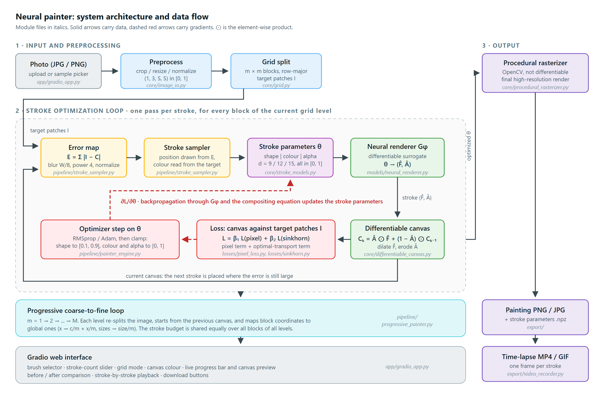
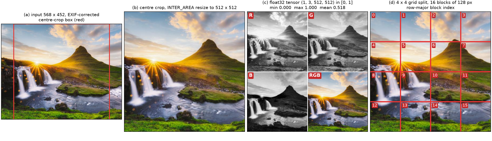
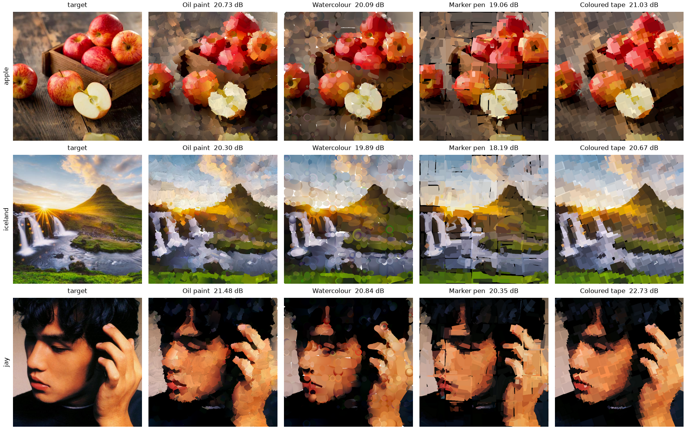
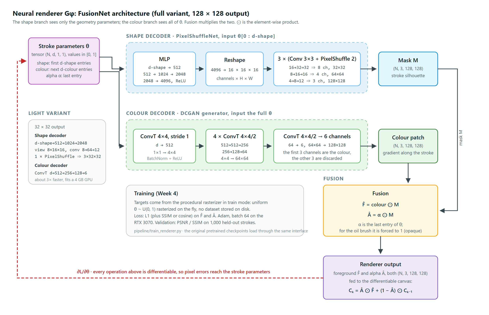
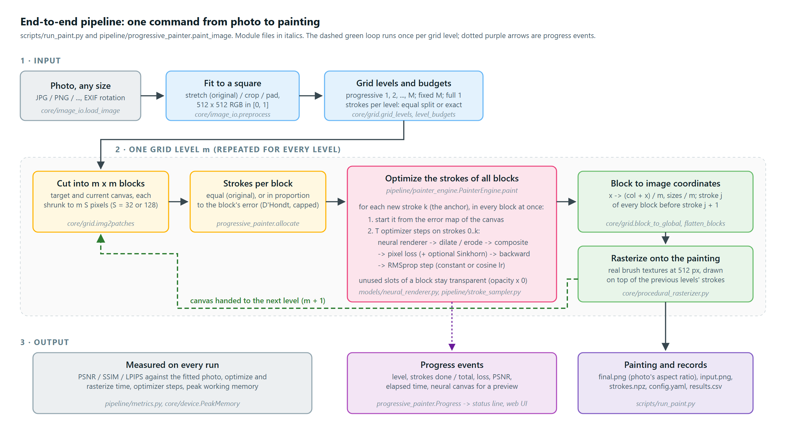
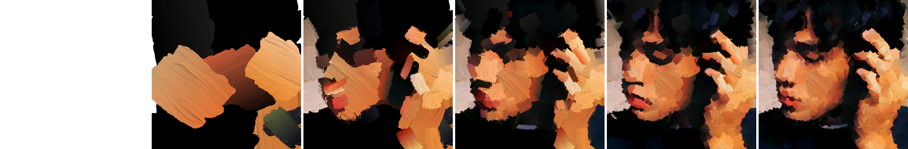
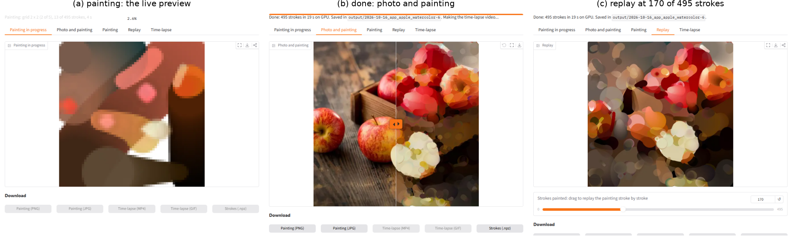
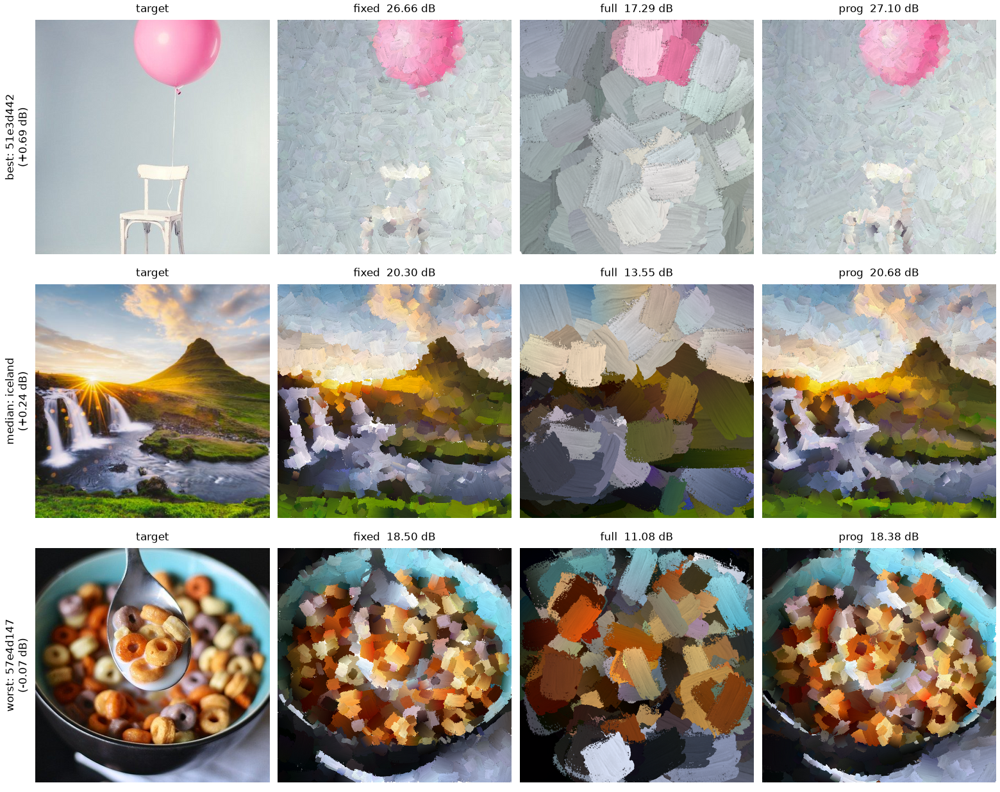

# How the Neural Painter works: a short overview

The Neural Painter turns a photo into a painting made of a few hundred brush strokes, by adjusting the strokes until a neural
copy of a real brush renders an image close to the photo. The method is that of Zou et al., *Stylized Neural Painting*
(CVPR 2021); this note describes how our re-implementation (`neural_painter/`) carries it out.

## 1. At a glance

*System architecture and data flow (Week 2). Solid arrows carry data, dashed red arrows carry gradients.*

The photo is preprocessed and cut into blocks; the stroke optimization loop fits the strokes of every block; the procedural
rasterizer draws them at full size; the painting, the strokes and the time-lapse are saved. The loop runs once per grid level,
coarse to fine, and inside it every stroke gets about 55 optimiser steps before the next one is placed. The neural renderer
*finds* the strokes; the procedural rasterizer *draws* them.

## 2. Images in and out

A photo enters as an RGB array of 32-bit floats in $[0, 1]$ and leaves as a $512 \times 512$ painting plus the list of strokes
that drew it. Everything in between works on that one format: `(H, W, 3)` in NumPy, `(1, 3, H, W)` as a PyTorch tensor.

1. **Load** (`core/image_io.py`, `load_image`). Accepts JPG, PNG, BMP, WebP and TIFF and applies the EXIF rotation. It refuses
   other formats, damaged files and anything above 40 million pixels with a clear message; the web page also refuses uploads
   above 40 MB.
2. **Normalise.** Grey, RGBA and 8-bit images become float32 RGB in $[0, 1]$. OpenCV's BGR order never leaves the loader.
3. **Fit to a square** (`fit`, default 512 px). Three policies: `stretch` (the original's behaviour; the painting is stretched
   back to the photo's shape when saved), `crop` (centre crop) and `pad` (letterbox). Shrinking uses area averaging, as the
   original does.
4. **Cut into blocks** (`core/grid.py`). For a grid of $m \times m$, the image is resized to $32m$ px and cut into $m^2$ blocks
   of $32 \times 32$ px, the size the renderer draws at. All blocks travel as one `(m², 3, 32, 32)` batch.
5. **Draw the result.** The optimised strokes are mapped from block coordinates back to whole-image coordinates and drawn once
   more, at 512 px, by the exact rasterizer (Section 3). That drawing is the painting you see.

*Preprocessing of one photo: (a) the input and its centre-crop box, (b) cropped and resized to 512 x 512, (c) the float32 tensor
per channel, (d) a 4 x 4 grid split with its row-major block index.*

Every run writes a new folder (never reused) under `output/` or `experiments/`:

| File | What it holds |
| :--- | :--- |
| `final.png` | The painting (the app also offers JPG) |
| `input.png` | The fitted photo the painting is scored against |
| `strokes.npz` | Every stroke's numbers in drawing order, plus the brush and canvas colour |
| `config.yaml` | Every setting, the device and the git commit |
| `results.csv` | PSNR, SSIM, time, stroke and step counts, peak memory |
| `timelapse.mp4`, `timelapse.gif` | The painting drawn stroke by stroke (optional) |

## 3. Strokes and brushes

A stroke is a short list of numbers, each in $[0, 1]$: where it sits, how big and how turned it is, its colour and its opacity.
The brush decides what the numbers mean. Each brush's layout is written once in `neural_painter/configs/<brush>.yaml` and read
through `BrushSpec` in `core/stroke_models.py`.

| Brush | What one stroke looks like | Numbers (shape / colour / opacity) |
| :--- | :--- | :--- |
| Oil paint | A textured brush patch (a scanned brush PNG) scaled, rotated and moved; colour fades from one end to the other; always opaque | 12 (5 / 6 / 1) |
| Watercolour | A curved stroke (quadratic Bezier) drawn by a disc whose radius and colour change along the curve; translucent | 15 (8 / 6 / 1) |
| Marker pen | A curved stroke drawn by a square pen of one colour | 12 (8 / 3 / 1) |
| Coloured tape | A solid rotated rectangle of one colour | 9 (5 / 3 / 1) |

The curve's middle control point is stored relative to the line between its two ends, so a stroke stays well formed whatever
the optimiser does to it.

*The same three photos painted with each brush (fixed 5 x 5 grid, 500 strokes, seed 0; report Figure 4.10).*

Every brush has two drawers. The **procedural rasterizer** (`core/procedural_rasterizer.py`) is a pixel-exact port of the
original `renderer.py`, written with OpenCV and NumPy: it draws the real picture but gives no gradients. The **neural renderer**
imitates it and does give gradients (Section 4).

## 4. The neural renderer

The neural renderer (`models/neural_renderer.py`) is a small network that has learned to draw strokes the way the rasterizer
does. Because it is differentiable, the error of the painting can be traced back to each stroke's numbers. Given $N$ strokes it
returns, for each, a colour image and a transparency (alpha) map of $S \times S$ pixels.

- **Architecture**: the "fusion" net of Zou et al. The shape numbers go through a fully connected decoder with PixelShuffle
  upsampling and give a mask; all the numbers go through transposed convolutions and give a colour image.
  Foreground = colour $\times$ mask, alpha = opacity $\times$ mask.
- **Sizes**: a full renderer draws at $S = 128$ px, a light one at $S = 32$ px. The pipeline and the web app use the authors'
  light renderers, which is why the blocks are $32 \times 32$.
- **Weights**: the eight 2021 checkpoints (full and light, four brushes) load through a renaming of their layer names; the
  outputs match the original code's in the tests. Renderers retrained with our own script load the same way.
- **The network is frozen while painting**: only the strokes are optimised, never the renderer.

*The fusion renderer: a shape branch makes the stroke's silhouette, a colour branch its colours, and their product is the
foreground and alpha that the canvas composites. The training box shows the Week 2 plan; the default loss became the reference's
mean squared error (report Section 4.1.5).*

**Training** (`pipeline/train_renderer.py`) follows the authors' recipe. Random stroke vectors are drawn by the rasterizer on
the fly as the teacher: 50,000 strokes per epoch, batch 64, Adam at $2 \times 10^{-4}$, the learning rate divided by 10 every
quarter of the run. The loss is the mean squared error of the colour image and the alpha map.

The CPU rasterizer, not the GPU, sets the training speed, so strokes are made by a pool of threads inside one process. Desktop
speeds, light renderers, 100 epochs:

| Brush | Strokes per second | 100 epochs |
| :--- | ---: | ---: |
| Coloured tape | 6,000 | 14 min |
| Oil paint | 1,600 | 51 min |
| Watercolour | 630 | 2.2 h |
| Marker pen | 420 | 3.3 h |

## 5. The painting loop

Strokes are added one at a time to every block, and after each new stroke all the strokes so far are nudged by gradient descent
so the canvas looks more like the photo (`pipeline/painter_engine.py`). Each stroke $k$ is laid over the canvas by alpha
compositing:

$$C_k = A_k \odot F_k + (1 - A_k) \odot C_{k-1}$$

where $F_k$ and $A_k$ are the renderer's colour image and alpha map for stroke $k$. The loss compares the final canvas $C$ with
the target block $I$:

$$\mathcal{L} = \beta_1 \, \lVert C - I \rVert_1 + \beta_{OT} \, \mathcal{L}_{\text{Sinkhorn}}(C, I)$$

The optional optimal-transport (Sinkhorn) term is off by default ($\beta_{OT} = 0$), as in the original.

For each new stroke the engine runs these steps, for all blocks at once as one GPU batch:

1. **Place it where the canvas is most wrong** (`pipeline/stroke_sampler.py`). The error map, the colour difference between
   photo and canvas, is blurred and raised to the 4th power, then one pixel is drawn from it at random. The stroke starts there,
   in the photo's colour at that pixel, with the brush's start size.
2. **Render and composite.** The neural renderer draws every stroke of the block; a $3 \times 3$ dilation and erosion tidy the
   edges; the strokes are composited in order onto the starting canvas.
3. **Score and update.** The loss is back-propagated to the stroke numbers and the RMSprop optimiser takes a step. Shape numbers
   are clamped to $[0.1, 0.9]$ so a stroke cannot collapse onto the block border; colour and opacity to $[0, 1]$.
4. **Repeat** steps 2 and 3 about 55 times per stroke (11 in fast mode). The learning rate starts at 0.004 and falls on a cosine
   curve over those steps.

**Coarse to fine.** The default "progressive" mode paints five levels in turn: a $1 \times 1$ grid, then $2 \times 2$, up to
$5 \times 5$, which is 55 blocks. The 500-stroke budget is shared equally, 9 strokes per block, so 495 strokes are painted. Each
level starts from the painting the earlier levels left: big strokes first, detail last. Because coarse strokes cross the borders
of the finer blocks, no seams of bare canvas show along the grid lines.

After each level its strokes are mapped to whole-image coordinates and drawn by the exact rasterizer at 512 px, and that picture
becomes the next level's starting canvas. Two other modes reproduce the original's demos: `fixed` (only the $5 \times 5$ grid)
and `full` (one block). The fast mode also gives more strokes to blocks with more error.

*One command from photo to painting (report Figure 4.13). The dashed green loop runs once per grid level.*

*Coarse to fine in practice: the blank canvas and the painting after 9, 45, 126, 270 and 495 strokes, the ends of the 1 x 1 to
5 x 5 levels (oil, report Figure 4.20).*

## 6. Backend and tech stack

The whole backend is one Python process: PyTorch does the optimisation, OpenCV and NumPy draw the strokes, Gradio serves the web
page and ffmpeg encodes the video. There is no database and no separate server; a painting's state lives in memory and its
results in a folder.

| Part | Library | Code |
| :--- | :--- | :--- |
| Optimisation, neural renderer | PyTorch 2.11 on `cuda`, `mps` (Apple) or `cpu` | `models/`, `pipeline/`, `losses/` |
| Stroke drawing, image files | OpenCV, NumPy, Pillow | `core/procedural_rasterizer.py`, `core/image_io.py` |
| Brush layouts | YAML | `configs/*.yaml` |
| Web page | Gradio 6.27 | `app/gradio_app.py` |
| Time-lapse | imageio-ffmpeg (H.264 MP4), Pillow (GIF) | `export/video_recorder.py` |
| Tests | pytest, 259 tests | `tests/` |

The device is always chosen explicitly (`core/device.get_device`), never set globally. On Windows every painting script first
opts out of power throttling, which otherwise moved background runs to the slow cores and made them 2 to 4 times slower.

There are two ways in, and both call the same function, `paint_image` in `pipeline/progressive_painter.py`, with the same
settings:

- **Command line**: `scripts/run_paint.py photo.jpg --brush oil --strokes 500`, with a live progress line in the terminal.
- **Web app**: `python -m neural_painter.app.gradio_app`, or a double-click on `Start_App.bat`, opens the page in the browser,
  in Vietnamese or English.

What happens when you press Paint in the web app:

1. The upload (40 MB at most) reaches `image_io` unprocessed, so bad files get a specific message in the page's language.
2. The photo is fitted to 512 px, the brush's renderer is loaded once per session, and `paint_image` starts in a worker thread.
3. The worker puts progress events on a queue. Every 0.3 s the page gets the newest one: the status line, the progress bar and a
   live preview of the canvas.
4. A per-stroke hook keeps about 100 frames for the replay slider, so the replay needs no second rendering.
5. When the painting is done it is saved under `output/` and the page shows the before/after comparison and the PNG, JPG and
   stroke downloads. About 4 s later the MP4 and GIF are ready.
6. Stop sets a flag that the worker checks at its next event, so a painting stops within about a second. Only one painting runs
   at a time (`concurrency_limit=1`); a second one waits in the queue, so two tabs cannot run the GPU out of memory.

*The web app: (a) the live preview while painting, (b) the finished painting with the before / after slider, (c) the replay
after 170 of 495 strokes.*

The time-lapse is not recorded during the painting. It is drawn again from the saved strokes, starting from a blank canvas, so
any saved painting can get one.

## 7. Speed and quality

On the desktop's RTX 3070 a 500-stroke oil painting takes about 12 s in progressive mode and under 0.4 GB of memory. On the CPU
it takes about 2 minutes.

| Device | Fixed grid | Progressive (default) |
| :--- | ---: | ---: |
| `cuda`, RTX 3070 | 5.7 s | 12 s |
| `cpu`, i5-13400F, 10 threads | 108 s | 130 s |

Light oil renderer, 500 strokes, each run alone (Week 7). Drawing the final 512 px picture adds 0.9 to 1.4 s, and each
time-lapse file about 2 s. The Apple `mps` rows are still to be measured on the MacBook.

Progressive mode is slower but better for every brush. Mean over 10 held-out images and 3 seeds (higher PSNR is better, lower
LPIPS is better):

| Brush | PSNR, fixed grid (dB) | PSNR, progressive (dB) | LPIPS, fixed / progressive |
| :--- | ---: | ---: | :--- |
| Oil paint | 20.30 | 20.63 | 0.528 / 0.517 |
| Watercolour | 19.76 | 22.06 | 0.494 / 0.441 |
| Marker pen | 19.09 | 21.16 | 0.523 / 0.444 |
| Coloured tape | 21.07 | 22.37 | 0.466 / 0.416 |

*Oil: target, fixed grid, full image and progressive painting for the image where progressive mode gains most, the median image
and the one where it loses most (report Figure 4.14).*

The gain is largest for thin or translucent brushes, whose fixed-grid paintings show bare canvas along the block borders. A full
comparison against the original 2021 code on all 30 frozen evaluation images is running in Week 9.

## Sources

All facts come from this repository: the code under `neural_painter/`, `CLAUDE.md`, `ROADMAP.md` and report chapter 4
(`report/chapters/04_implementation.md`, Sections 4.1, 4.2, 4.4 to 4.6 and Table 4.30).
