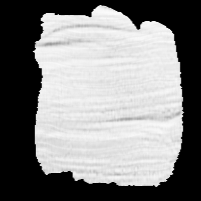
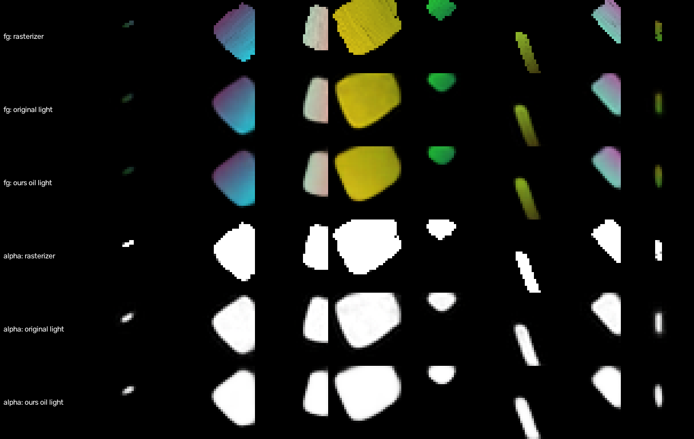

# Hệ thống vẽ tranh hoạt động thế nào (giải thích dễ hiểu)

Ghi chú này trả lời ba câu hỏi:

1. Ảnh đưa vào được xử lý thế nào?
2. Cọ vẽ là gì?
3. Vì sao máy tính biết đặt cọ ở đâu?

Ví dụ xuyên suốt: một ảnh chụp điện thoại $3000 \times 4000$ pixel, cọ sơn dầu, 500 nét, chế độ "Coarse to fine".
Bản chi tiết hơn có công thức: [`image_processing_vi.md`](image_processing_vi.md) và
[`normalization_vi.md`](normalization_vi.md).

**Ý chính cần nhớ:** máy tính không "hiểu" ảnh. Nó không biết đâu là khuôn mặt hay quả táo. Nó chỉ làm một việc:
**so tranh đang vẽ với ảnh gốc, con số với con số, rồi sửa nét để hai bên giống nhau hơn.**

---

## Phần 1. Ảnh đầu vào được xử lý thế nào

### Bước 1: ảnh là một bảng số

Phóng to một tấm ảnh thật nhiều, bạn sẽ thấy nó gồm những ô vuông nhỏ, mỗi ô một màu. Mỗi ô vuông đó là một
**pixel** (điểm ảnh). Với máy tính, ảnh là một bảng: ảnh điện thoại có 3000 hàng và 4000 cột, mỗi ô của bảng là một
pixel.

Màu của một pixel được ghi bằng 3 số: mức **đỏ**, **xanh lá** và **xanh dương** (R, G, B), mỗi số từ 0 đến 255.
Ví dụ, một ảnh tí hon chỉ có 2 hàng và 3 cột (6 pixel) trông như thế này với máy tính:

| | cột 0 | cột 1 | cột 2 |
| :--- | :---: | :---: | :---: |
| **hàng 0** | (0, 0, 0) | (200, 120, 40) | (255, 255, 255) |
| **hàng 1** | (200, 120, 40) | (200, 120, 40) | (255, 255, 255) |

Mỗi ô ở trên là **một pixel** với bộ 3 số của nó:

- $(0, 0, 0)$: không có chút đỏ, xanh lá hay xanh dương nào, nên là **đen**;
- $(255, 255, 255)$: cả ba màu đều mạnh nhất, nên là **trắng**;
- $(200, 120, 40)$: nhiều đỏ, vừa xanh lá, ít xanh dương, nên là **cam nâu** (giống màu da).

Ảnh thật cũng vậy, chỉ lớn hơn: $3000 \times 4000 = 12$ triệu ô (pixel), mỗi ô 3 số, tức 36 triệu con số.

### Bước 2: đổi về thang 0 đến 1 (chuẩn hoá)

Mỗi số được chia cho 255:

$$
(200, 120, 40) \;\rightarrow\; \left(\tfrac{200}{255}, \tfrac{120}{255}, \tfrac{40}{255}\right) = (0.78, 0.47, 0.16).
$$

**Vì sao?** Để ảnh và cọ vẽ dùng cùng một đơn vị. Màu của cọ vẽ là số từ 0 (không có màu đó) đến 1 (đậm nhất).
Muốn so màu ảnh với màu cọ thì cả hai phải cùng thang, giống như không thể so trực tiếp 1.7 m với 170 cm mà không
đổi đơn vị trước. Sau bước này, 0 là đen, 1 là trắng, và màu ảnh có thể đem gán thẳng làm màu cọ.

### Bước 3: thu nhỏ về $512 \times 512$

Đến bước này ảnh **đã được chuẩn hoá** (bước 2), nên mọi số đều nằm trong $[0, 1]$: 0 là đen, 1 là trắng. Các ví dụ
dưới đây cũng dùng thang đó.

**Ví dụ nhỏ trước.** Thu nhỏ một ảnh xám $4 \times 4$ (mỗi pixel 1 số cho dễ nhìn) thành $2 \times 2$. Chia ảnh cũ
thành 4 nhóm, mỗi nhóm $2 \times 2$ pixel. Mỗi nhóm gộp lại thành **1 pixel mới** bằng cách **lấy trung bình cộng**
(*mean*, không phải trung vị *median*):

Ảnh cũ $4 \times 4$ (16 pixel):

| | | | |
| :---: | :---: | :---: | :---: |
| **0.04** | **0.08** | *0.78* | *0.86* |
| **0.12** | **0.16** | *0.94* | *0.86* |
| 0.39 | 0.39 | `0` | `0` |
| 0.39 | 0.39 | `0` | `0.16` |

Ảnh mới $2 \times 2$ (4 pixel):

| | |
| :---: | :---: |
| $\frac{0.04 + 0.08 + 0.12 + 0.16}{4} = 0.10$ | $\frac{0.78 + 0.86 + 0.94 + 0.86}{4} = 0.86$ |
| $\frac{0.39 + 0.39 + 0.39 + 0.39}{4} = 0.39$ | $\frac{0 + 0 + 0 + 0.16}{4} = 0.04$ |

Ảnh màu thì làm y hệt cho từng kênh R, G, B riêng. Ví dụ gộp 2 pixel cam nâu $(0.78, 0.47, 0.16)$ với 2 pixel trắng
$(1, 1, 1)$:

$$
\left(\tfrac{0.78 + 0.78 + 1 + 1}{4},\; \tfrac{0.47 + 0.47 + 1 + 1}{4},\; \tfrac{0.16 + 0.16 + 1 + 1}{4}\right)
= (0.89,\; 0.735,\; 0.58),
$$

tức một màu cam nhạt, giống như pha cam nâu với trắng.

*Muốn nghĩ theo thang 0..255 cũ thì nhân 255: các số trên chính là 10, 20, 30, 40, 200, 220, 240, 100 chia 255. Chia 255
và lấy trung bình đều là phép tuyến tính, nên đổi thứ tự (thu nhỏ trước rồi mới chia) cũng ra gần như cùng kết quả, chỉ
khác phần làm tròn rất nhỏ. Hệ thống làm theo thứ tự chuẩn hoá trước, thu nhỏ sau (`core/image_io.py`, hàm
`preprocess`).* Giống khi bạn đứng xa một bức tranh: các chấm màu nhỏ hoà vào
nhau, bạn thấy màu chung của cả vùng chứ không thấy từng chấm.

**Ảnh thật $3000 \times 4000 \rightarrow 512 \times 512$.** Làm đúng như trên, chỉ là mỗi nhóm lớn hơn:

- theo chiều dọc: $3000 / 512 \approx 5.86$ hàng cũ gộp thành 1 hàng mới;
- theo chiều ngang: $4000 / 512 \approx 7.81$ cột cũ gộp thành 1 cột mới;
- vậy mỗi pixel mới là trung bình của khoảng $5.86 \times 7.81 \approx 46$ pixel cũ.

Vì 5.86 và 7.81 không phải số nguyên, mép của mỗi nhóm cắt ngang qua một số pixel cũ. Pixel cũ nằm trong nhóm bao nhiêu
phần thì được tính bấy nhiêu phần, ví dụ nằm một nửa thì được tính một nửa. Trong mã, việc này do `cv2.INTER_AREA`
làm (`core/image_io.py`). Ảnh từ 12 triệu pixel còn $512 \times 512 = 262\,144$ pixel, ít hơn khoảng 46 lần.

**Vì sao lấy trung bình, không lấy đại 1 pixel trong nhóm?** Nếu chỉ lấy 1 pixel, có thể trúng một chấm lạ (một hạt
bụi trắng, một sợi tóc) không đại diện cho cả vùng, và ảnh nhỏ bị lấm tấm, răng cưa. Lấy trung bình thì mọi pixel cũ
đều góp phần.

**Vì sao phải thu nhỏ?** Quá trình vẽ lặp lại hàng nghìn lần phép "vẽ thử rồi so với ảnh". Ít hơn 46 lần số pixel thì
mỗi lần so nhanh hơn rất nhiều. Tranh vẽ bằng cọ cũng không cần chi tiết tới từng sợi tóc. Đổi lại, chi tiết nhỏ hơn
khoảng $1/512$ bề ngang ảnh sẽ mất.

**Ảnh bị ép thành hình vuông.** Chiều ngang bị co mạnh hơn chiều dọc (7.81 so với 5.86), nên ở chế độ mặc định ảnh bị ép
hẹp lại: một hình tròn sẽ thành hình bầu dục đứng. Tranh được vẽ trên ảnh vuông này, rồi đến cuối được kéo về đúng tỉ lệ
$3 : 4$ ($384 \times 512$). Nếu chọn "Crop", hai mép trái phải bị cắt trước cho ảnh thành $3000 \times 3000$, nên không
bị ép, nhưng mất hai mép ảnh.

Bước 4 dưới đây lại dùng đúng cách lấy trung bình này để thu ảnh $512 \times 512$ về các ô nhỏ hơn. Ở lần thu nhỏ
thứ hai đó, bài gốc không lấy trung bình; dự án đổi sang lấy trung bình và đo được tranh tốt hơn $+0.32$ dB PSNR.

### Bước 4: chia thành các ô $32 \times 32$

"Bộ não" vẽ của hệ thống (mạng neural, Phần 3) chỉ vẽ được một ô vuông $32 \times 32$ pixel. Vì vậy ảnh được chia
thành lưới các ô, và mỗi ô được thu về $32 \times 32$. Tranh được vẽ qua 5 vòng, lưới mịn dần:

| Vòng | Lưới | Số ô | Mỗi ô phủ bao nhiêu trên ảnh 512 | Nét mỗi ô |
| :---: | :---: | :---: | :---: | :---: |
| 1 | $1 \times 1$ | 1 | cả ảnh | 9 |
| 2 | $2 \times 2$ | 4 | $256 \times 256$ px | 9 |
| 3 | $3 \times 3$ | 9 | $171 \times 171$ px | 9 |
| 4 | $4 \times 4$ | 16 | $128 \times 128$ px | 9 |
| 5 | $5 \times 5$ | 25 | $102 \times 102$ px | 9 |

Tổng cộng $9 \times (1 + 4 + 9 + 16 + 25) = 495$ nét. Vòng 1 dùng nét to để phủ mảng màu lớn. Vòng 5 dùng nét nhỏ
cho chi tiết. Giống cách hoạ sĩ vẽ thật: lót nền trước, tả chi tiết sau.

---

## Phần 2. Cọ vẽ là gì

### Một nét cọ là 12 con số

Với máy tính, một nét cọ sơn dầu chỉ là **một dãy 12 số**, mỗi số từ 0 đến 1 (file `neural_painter/configs/oil_brush.yaml`):

| Số | Tên | Ý nghĩa | Ví dụ |
| :---: | :--- | :--- | :--- |
| 1, 2 | $x_c, y_c$ | vị trí tâm nét | $(0.5, 0.5)$ = giữa ảnh, pixel $(256, 256)$ |
| 3, 4 | $w, h$ | chiều rộng, chiều cao | $w = 0.3$: rộng khoảng $0.3 \times 512 \approx 154$ px |
| 5 | $\theta$ | góc xoay | $\theta \times 180°$, ví dụ $0.25$ là xoay $45°$ |
| 6, 7, 8 | $r_0, g_0, b_0$ | màu ở đầu nét | $(0.78, 0.47, 0.16)$ = cam nâu |
| 9, 10, 11 | $r_2, g_2, b_2$ | màu ở cuối nét | màu chuyển dần từ đầu đến cuối nét |
| 12 | $\alpha$ | độ trong suốt | với sơn dầu luôn bị đặt là 1 (đặc, che kín) |

Tranh 495 nét vì vậy chỉ là một bảng $495 \times 12$ con số. Bảng này được lưu trong file `strokes.npz`.

### Vẽ một nét từ 12 con số ra hình

Hệ thống có sẵn 4 ảnh **mẫu vệt cọ** (texture) chụp từ cọ thật, trong `neural_painter/assets/brushes/`:

Để vẽ một nét (`core/procedural_rasterizer.py`):

1. Tô màu mẫu vệt cọ: hàng trên cùng màu $(r_0, g_0, b_0)$, hàng dưới cùng màu $(r_2, g_2, b_2)$, ở giữa pha dần.
2. Kéo giãn mẫu thành kích thước $w \times h$.
3. Xoay một góc $\theta \times 180°$.
4. Đặt tâm vào điểm $(x_c, y_c)$.
5. Dán lên tranh. Chỗ có nét thì màu nét che màu cũ, chỗ không có nét giữ nguyên.

Cách dán được viết thành công thức:

$$
\text{tranh mới} = A \cdot \text{màu nét} + (1 - A) \cdot \text{tranh cũ},
$$

trong đó $A = 1$ ở chỗ có nét và $A = 0$ ở chỗ không có nét.

### Bốn loại cọ

Mỗi loại cọ có cách vẽ và số tham số riêng: sơn dầu 12 số, màu nước 15, bút dạ 12, băng dính màu 9.

---

## Phần 3. Vì sao máy tính biết đặt cọ ở đâu

Máy tính làm hai việc cho mỗi nét:

- **(A) Chọn chỗ đặt ban đầu:** đặt nét vào chỗ tranh đang **sai nhiều nhất** so với ảnh.
- **(B) Tinh chỉnh:** nhích vị trí, kích thước, góc và màu từng chút một sao cho tranh giống ảnh hơn.

### (A) Chọn chỗ đặt: "bản đồ sai lệch"

Ở mỗi ô, máy tính lấy ảnh gốc trừ tranh đang vẽ, pixel với pixel, rồi lấy trị tuyệt đối. Kết quả là một **bản đồ
sai lệch**: chỗ nào số lớn là chỗ tranh còn khác ảnh nhiều (`pipeline/stroke_sampler.py`).

**Ví dụ bằng số.** Một ô ảnh xám $4 \times 4$: nửa trái tối (giá trị 0.2), nửa phải sáng (0.9). Tranh lúc đầu là
canvas trắng (1.0).

| | Nửa trái (8 ô, tối) | Nửa phải (8 ô, sáng) |
| :--- | :---: | :---: |
| Ảnh gốc | 0.2 | 0.9 |
| Tranh hiện tại (trắng) | 1.0 | 1.0 |
| Sai lệch $\lvert \text{ảnh} - \text{tranh} \rvert$ | 0.8 | 0.1 |
| Sai lệch mũ 4 | 0.4096 | 0.0001 |
| Xác suất chọn mỗi ô | 12.5 % | 0.003 % |
| Xác suất chọn cả nửa | **99.98 %** | 0.02 % |

Cách làm:

1. **Làm mờ bản đồ** (lấy trung bình trên một ô vuông nhỏ $4 \times 4$ pixel). Nhờ vậy cả một **vùng** sai được ưu
   tiên hơn một pixel lẻ bị nhiễu.
2. **Mũ 4.** Chỗ sai gấp đôi được ưu tiên gấp $2^4 = 16$ lần. Trong ví dụ, nếu không lấy mũ thì nửa trái chỉ được
   chọn 89 % số lần; có mũ 4 thì là 99.98 %. Nét gần như chắc chắn rơi vào chỗ sai nhất.
3. **Bốc thăm** một điểm theo các xác suất đó. Điểm bốc được là **tâm** của nét mới.
4. **Màu ban đầu** của nét là màu của ảnh gốc ngay tại điểm đó (trong ví dụ là 0.2, xám tối). Kích thước ban đầu là
   ngẫu nhiên trong khoảng 0.2 đến 0.4 bề ngang ô, góc là ngẫu nhiên.

Vậy ngay từ đầu, nét mới đã nằm **đúng chỗ sai** và có **đúng màu cần**. Sau khi vẽ nét đó, chỗ ấy hết sai, bản đồ sai
lệch thay đổi, và nét tiếp theo tự động đi tìm chỗ sai tiếp theo.

Thực nghiệm của dự án: chọn chỗ đặt theo bản đồ sai lệch tốt hơn chọn ngẫu nhiên đều khắp ô $+0.87$ dB PSNR (báo cáo,
chương 2).

### (B) Tinh chỉnh: thử, đo, sửa

Chỗ đặt ban đầu chỉ là ước lượng thô. Sau đó máy tính chỉnh cả 12 số của mọi nét trong ô, lặp lại nhiều lần:

1. Vẽ tất cả các nét hiện có ra tranh.
2. Đo **độ sai** của tranh: trung bình của $\lvert \text{ảnh} - \text{tranh} \rvert$ trên mọi pixel. Số này càng nhỏ
   thì tranh càng giống ảnh.
3. Với **từng con số** của từng nét, tính: "nếu tăng số này lên một chút thì độ sai tăng hay giảm, và nhanh cỡ nào?"
   Đại lượng đó gọi là **đạo hàm** (gradient).
4. Nhích mỗi số một chút theo hướng làm độ sai **giảm**:

$$
\text{số mới} = \text{số cũ} - (\text{bước nhỏ}) \times \frac{\partial\, \text{độ sai}}{\partial\, \text{số đó}} .
$$

Ví dụ: nếu nét đang lấn sang vùng sáng một chút thì đạo hàm theo $x_c$ cho biết "dời sang trái thì bớt sai", và
$x_c$ giảm đi một ít. Tương tự, nét có thể hẹp lại, xoay đi hoặc đổi màu.

**Hình ảnh so sánh:** một người bịt mắt đứng trên sườn đồi và muốn xuống chỗ thấp nhất. Người đó không thấy đường, nhưng
cảm nhận được dốc dưới chân, nên mỗi lần bước một bước nhỏ về phía dốc xuống. Ở đây "độ cao" là độ sai của tranh, còn
"vị trí" là 12 con số của các nét.

Mỗi khi thêm một nét mới, máy tính làm 55 lần chỉnh như vậy cho tất cả các nét đã có trong ô (chế độ "Best quality").

### Vì sao cần mạng neural

Có một vấn đề: cách vẽ thật ở Phần 2 (dán ảnh mẫu, làm tròn về pixel) **không cho tính đạo hàm**. Dời $x_c$ một chút
xíu thì nét vẫn nằm trên cùng các pixel, tranh không đổi gì; dời thêm chút nữa thì nét nhảy hẳn sang pixel bên cạnh.
Tranh thay đổi theo kiểu bậc thang, nên máy tính không biết nên dời về hướng nào.

Giải pháp là một **mạng neural** được huấn luyện để **bắt chước** cọ thật: đưa vào 12 con số, nó vẽ ra một ô
$32 \times 32$ gần giống cọ thật vẽ (`models/neural_renderer.py`). Nó học bằng cách xem rất nhiều nét ngẫu nhiên do cọ
thật vẽ. Khi vẽ tranh, hệ thống dùng mạng đã huấn luyện sẵn của bài gốc; dự án cũng tự huấn luyện lại một mạng sơn dầu
(100 lượt, mỗi lượt 50 000 nét mới, tổng cộng 5 triệu nét) để kiểm chứng, và hai mạng vẽ gần giống nhau. Khác biệt quan trọng: hình mạng neural vẽ ra **thay đổi mượt** khi các con số thay đổi, nên tính được
đạo hàm.

*Hàng 1 là cọ thật, hàng 2 và 3 là mạng neural của bài gốc và của dự án. Ba hàng dưới là hình dạng nét (trắng = có
nét). Mạng neural vẽ gần giống, chỉ mềm mép hơn.*

Vì vậy hệ thống dùng hai bộ vẽ:

| | Dùng khi | Ưu điểm |
| :--- | :--- | :--- |
| Mạng neural | tinh chỉnh nét (bước B) | tính được đạo hàm |
| Cọ thật | vẽ tranh cuối cùng, $512 \times 512$ | đẹp, có vân cọ thật |

Khi đã chỉnh xong, 495 dãy số được đưa cho **cọ thật** vẽ lại thành tranh cuối cùng.

### Toàn bộ quá trình qua từng vòng

*Từ trái sang: canvas trống, rồi tranh sau 9, 45, 126, 270 và 495 nét, tức là cuối mỗi vòng, từ lưới $1 \times 1$ đến
$5 \times 5$. Vòng đầu là các mảng màu lớn, vòng cuối là chi tiết mắt, môi, ngón tay.*

---

## Tóm tắt để trả lời thầy

**1. Ảnh đầu vào xử lý thế nào?**
Ảnh là một bảng số: mỗi pixel gồm 3 số R, G, B từ 0 đến 255. Hệ thống chia cho 255 để đưa về thang 0 đến 1, cùng thang
với màu cọ. Sau đó ảnh được thu nhỏ về $512 \times 512$ bằng cách lấy trung bình, rồi chia thành các ô $32 \times 32$
qua 5 vòng lưới, từ $1 \times 1$ đến $5 \times 5$.

**2. Cọ vẽ là gì?**
Một nét cọ là 12 con số: vị trí, kích thước, góc xoay, màu đầu, màu cuối, độ trong suốt. Để vẽ, hệ thống lấy ảnh mẫu
vệt cọ thật, tô màu, kéo giãn, xoay, đặt vào vị trí rồi dán lên tranh. Cả bức tranh chỉ là 495 dãy 12 số như vậy.

**3. Vì sao máy tính biết đặt cọ ở đâu?**
Có hai bước.
- Đặt ban đầu: so tranh với ảnh để lập bản đồ sai lệch, rồi đặt nét mới vào chỗ sai nhiều nhất (sai lệch được lấy mũ 4
  nên chỗ sai nhất gần như luôn được chọn), với màu lấy từ ảnh tại đó.
- Tinh chỉnh: dùng đạo hàm để biết dời, co giãn, xoay, đổi màu nét theo hướng nào thì tranh bớt sai, và lặp lại nhiều
  lần. Đạo hàm tính được nhờ một mạng neural đã học bắt chước cọ thật.

Máy tính không nhận ra vật thể nào trong ảnh. Nó chỉ làm cho các con số của tranh gần với các con số của ảnh.
