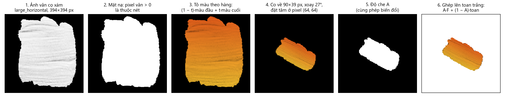
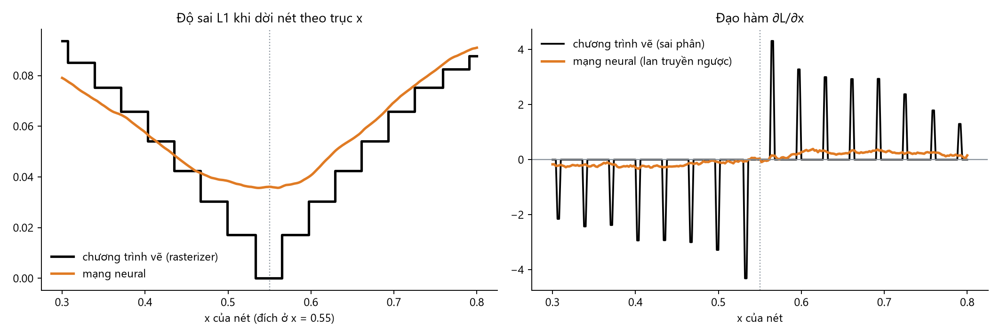
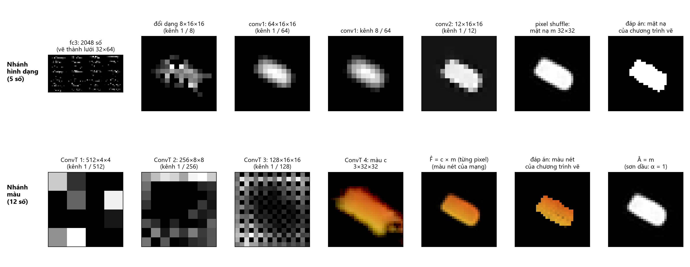

# Mạng neural trong dự án hoạt động thế nào

Ghi chú này giải thích, từng bước và bằng con số cụ thể, hai thứ mà các ghi chú trước gọi tắt là "cọ thật" và "cọ giả":

- **Chương trình vẽ nét** (*procedural rasterizer*, tệp `neural_painter/core/procedural_rasterizer.py`): một chương trình bình thường, viết bằng OpenCV, biến 12 con số thành một bức ảnh có hình nét cọ.
- **Mạng neural kết xuất** (*neural renderer*, tệp `neural_painter/models/neural_renderer.py`): một mạng neural được huấn luyện để làm **đúng cùng việc đó**, nhưng theo cách tính được đạo hàm.

Mọi con số dưới đây lấy từ mã nguồn và từ mạng đã huấn luyện của bài gốc cho chất liệu sơn dầu (bản nhẹ, ô 32 × 32 pixel), là mạng hệ thống dùng khi vẽ. Ba hình trong ghi chú được tạo bằng chính mã và trọng số đó.

---

## 1. Một nét cọ trong máy tính là gì

Với máy tính, một nét sơn dầu chỉ là **12 con số**, mỗi số nằm trong đoạn [0, 1]:

| Vị trí | Ký hiệu | Ý nghĩa | Đổi ra pixel (toan rộng $W$) |
| :--- | :--- | :--- | :--- |
| 1, 2 | $x, y$ | tâm nét, tính theo cạnh toan | $x_0 = \lfloor x (W-1) + 0.5 \rfloor$ |
| 3, 4 | $w, h$ | chiều dài và bề rộng nét | $w_{px} = \lfloor 1 + w W \rfloor$ |
| 5 | $\theta$ | góc xoay | góc thật $= \pi \theta$ (0 đến 180°) |
| 6–8 | $r_0, g_0, b_0$ | màu ở đầu nét | |
| 9–11 | $r_2, g_2, b_2$ | màu ở cuối nét | |
| 12 | $\alpha$ | độ che | sơn dầu bỏ qua số này, nét luôn che kín |

Năm số đầu là **hình dạng**, sáu số tiếp là **màu**, số cuối là **độ che**. Bức tranh là một danh sách vài trăm dãy số như vậy, vẽ lần lượt.

Ví dụ dùng xuyên suốt ghi chú: $p = (0.5,\ 0.5,\ 0.70,\ 0.30,\ 0.15,\ 0.90, 0.35, 0.10,\ 0.98, 0.80, 0.20,\ 1)$: một nét nằm giữa toan, dài và hẹp, nghiêng, màu cam ở đầu chuyển sang vàng ở cuối.

---

## 2. Chương trình vẽ nét: 12 con số thành ảnh như thế nào

Hàm `_draw_oilpaintbrush` và `create_transformed_brush` làm sáu bước dưới đây. Hình 1 cho thấy từng bước với nét ví dụ trên toan 128 × 128.

**Hình 1.** Chương trình vẽ nét biến 12 con số thành một nét sơn dầu, từng bước.

### Bước 1: đổi các con số ra pixel

Với toan $W = 128$:

- tâm: $x_0 = \lfloor 0.5 \cdot 127 + 0.5 \rfloor = 64$, $y_0 = 64$;
- kích thước: $w_{px} = \lfloor 1 + 0.70 \cdot 128 \rfloor = 90$ pixel, $h_{px} = \lfloor 1 + 0.30 \cdot 128 \rfloor = 39$ pixel;
- góc: $\pi \cdot 0.15$ rad $= 27°$.

Chú ý hàm làm tròn $\lfloor \cdot \rfloor$: đây là chỗ đầu tiên khiến chương trình không có đạo hàm (mục 3).

### Bước 2: chọn một ảnh vân cọ

Dự án có sẵn **4 ảnh xám** của một vệt sơn quét bằng cọ, lấy từ bài gốc (thư mục `neural_painter/assets/brushes/`, tên tệp `brush_fromweb2_...`): hai ảnh "lớn" 394 × 394 pixel và hai ảnh "nhỏ" 101 × 197 pixel, mỗi cỡ có một bản nằm ngang và một bản dọc. Mỗi pixel của ảnh vân là một số từ 0 đến 255: bằng 0 ở ngoài nét, từ 1 đến 252 bên trong nét (trung vị 232). Các pixel tối hơn trong nét chính là các vệt lông cọ.

Chương trình chọn ảnh theo hai luật:

- ảnh **lớn** nếu nét chiếm hơn 10 % diện tích toan, tức $w_{px} h_{px} / W^2 > 0.1$; ở ví dụ là $90 \cdot 39 / 128^2 = 0.21$, nên chọn ảnh lớn;
- ảnh **dọc** nếu $h_{px} > w_{px}$, ngược lại là ảnh ngang; ở ví dụ chọn ảnh ngang.

### Bước 3: làm mặt nạ

Mặt nạ cho biết pixel nào thuộc nét: pixel nào của ảnh vân lớn hơn 0 thì mặt nạ bằng 255, còn lại bằng 0 (Hình 1, ô 2). Đây là một **phép so ngưỡng**, chỗ thứ hai khiến chương trình không có đạo hàm.

### Bước 4: tô màu theo từng hàng

Ảnh vân có $N$ hàng (394 với ảnh lớn). Hàng thứ $i$ nhận một màu trộn giữa màu đầu và màu cuối:

$$\text{màu}(i) = (1 - t_i)\, c_0 + t_i\, c_2, \qquad t_i = \frac{i}{N}, \qquad c_0 = (r_0, g_0, b_0),\ c_2 = (r_2, g_2, b_2)$$

Sau đó mỗi pixel lấy màu của hàng nhân với độ sáng của ảnh vân tại pixel đó: $\text{pixel} = \frac{\text{vân}}{255} \cdot \text{màu}(i) \cdot 255$. Vì vậy chỗ vân tối thành vệt sẫm trên nét, và màu chuyển dần từ cam (hàng trên) sang vàng (hàng dưới) (Hình 1, ô 3).

### Bước 5: co giãn, xoay và đặt vào toan

Ảnh màu và mặt nạ cùng đi qua một **phép biến đổi affine**, ghép từ bốn phép đơn giản theo thứ tự:

1. dịch để tâm ảnh vân về gốc toạ độ: dịch $(-197, -197)$ với ảnh 394 × 394;
2. co giãn về đúng cỡ nét: nhân chiều ngang với $90/394$ và chiều dọc với $39/394$;
3. xoay một góc $27°$;
4. dịch tâm tới pixel $(x_0, y_0) = (64, 64)$.

Bốn phép này gộp thành một ma trận $2 \times 3$. Hàm `cv2.warpAffine` dùng ma trận đó để tính, với mỗi pixel của toan, pixel tương ứng trên ảnh vân rồi nội suy giá trị; pixel nào rơi ra ngoài ảnh vân thì bằng 0. Kết quả là hai ảnh cỡ $W \times W$ (Hình 1, ô 4 và 5):

- $F$ (*foreground*): màu nét tại mỗi pixel;
- $A$ (*alpha*): độ che tại mỗi pixel, 1 trong nét, 0 ngoài nét, giá trị lẻ ở mép.

Cả hai được chia cho 255 để nằm trong [0, 1].

### Bước 6: ghép nét lên tranh

Nét được ghép lên tranh hiện có theo công thức ghép lớp alpha, áp dụng cho từng pixel và từng kênh màu:

$$C_{\text{mới}} = A \cdot F + (1 - A) \cdot C_{\text{cũ}}$$

Pixel có $A = 1$ lấy màu nét, pixel có $A = 0$ giữ màu cũ (Hình 1, ô 6). Khi vẽ tranh cuối, chương trình còn nở $F$ và co $A$ một chút (cửa sổ 2 × 2) để che các khe hở mảnh ở mép nét. Khi tạo dữ liệu huấn luyện thì không làm bước này.

### Ba chất liệu còn lại

Cùng ý tưởng (số thành pixel rồi ghép lớp), chỉ khác cách vẽ hình:

- **màu nước:** một đường cong Bézier bậc hai qua 3 điểm; vẽ 100 hình tròn dọc đường cong, bán kính đổi dần từ $r_0$ đến $r_2$, màu chuyển dần, độ che bằng $\alpha$;
- **bút dạ:** cũng là đường cong Bézier, nhưng vẽ 100 hình vuông xoay theo hướng đường cong, một màu, một bề rộng;
- **băng dính màu:** một hình chữ nhật xoay, tô một màu.

---

## 3. Vì sao chương trình vẽ nét không có đạo hàm

Để chỉnh nét bằng hạ gradient, ta cần biết: nếu tăng $x$ thêm một chút, độ sai giữa tranh và ảnh tăng hay giảm, nhanh cỡ nào. Đó là đạo hàm $\partial L / \partial x$. Chương trình vẽ nét không cho con số này, vì ba thao tác ở mục 2:

1. **Làm tròn ra pixel** ($\lfloor \cdot \rfloor$ ở bước 1): trên toan 32 pixel, mọi $x$ trong khoảng rộng $1/31 \approx 0.032$ cho cùng một $x_0$. Trong khoảng đó ảnh không đổi, nên đạo hàm bằng 0; ở ranh giới, ảnh nhảy hẳn một pixel.
2. **So ngưỡng** (bước 3): một pixel hoặc thuộc nét hoặc không, không có trạng thái "thuộc một chút".
3. **Chọn ảnh vân** (bước 2): khi diện tích vượt 10 % hay khi $h_{px}$ vượt $w_{px}$, chương trình đổi hẳn sang ảnh vân khác, ảnh nhảy đột ngột.

Mình đã đo trực tiếp (Hình 2, đường đen): lấy một nét đích ở $x = 0.55$, dời một nét giống hệt từ $x = 0.30$ đến $0.80$ qua 251 vị trí, mỗi vị trí vẽ bằng chương trình rồi tính độ sai L1 so với đích. Độ sai là một **hàm bậc thang**. Đạo hàm bằng **đúng 0 ở 87 % số vị trí**, và ở các vị trí còn lại thì vọt lên thành gai nhọn. Thuật toán hạ gradient đứng ở một bậc thang sẽ nhận đạo hàm 0 và không biết dời nét về hướng nào.

**Hình 2.** Trái: độ sai L1 khi dời nét theo trục $x$, với chương trình vẽ nét (đen) và với mạng neural (cam). Phải: đạo hàm của độ sai theo $x$. Đạo hàm của mạng âm khi nét ở bên trái đích và dương khi nét ở bên phải đích, tức chỉ về phía đích.

---

## 4. Mạng neural: cùng việc, nhưng tính được đạo hàm

Mạng neural $G_\varphi$ nhận cùng 12 con số và trả về cùng hai ảnh như chương trình vẽ, nhưng nhỏ hơn: $\hat F$ (màu nét) và $\hat A$ (độ che), mỗi ảnh $3 \times 32 \times 32$. Ký hiệu $\varphi$ là toàn bộ **trọng số** của mạng: 5 366 860 con số, tìm ra bằng huấn luyện (mục 5).

Mạng chỉ gồm các phép tính trơn: nhân, cộng, lấy max. Vì vậy với mọi đầu vào, PyTorch tính được đạo hàm của từng pixel đầu ra theo từng con số đầu vào.

### 4.1. Các khối xây dựng

| Khối | Làm gì | Công thức |
| :--- | :--- | :--- |
| Lớp kết nối đầy đủ (`Linear`) | mỗi số đầu ra là tổng có trọng số của **mọi** số đầu vào, cộng một hằng số | $y = W x + b$ |
| ReLU | giữ số dương, đổi số âm thành 0 | $\max(0, z)$ |
| Tích chập 3 × 3 (`Conv2d`) | mỗi pixel đầu ra là tổng có trọng số của vùng 3 × 3 quanh nó, trên mọi kênh đầu vào | $y_{k}(i,j) = b_k + \sum_{c} \sum_{u,v=-1}^{1} K_{k,c}(u,v)\, x_c(i+u, j+v)$ |
| Xếp lại điểm ảnh (`PixelShuffle(2)`) | lấy 4 kênh cỡ $16 \times 16$ xếp thành 1 kênh cỡ $32 \times 32$: 4 giá trị cùng vị trí thành một ô 2 × 2 | $y_c(2i+a, 2j+b) = x_{4c + 2a + b}(i, j)$ |
| Tích chập chuyển vị (`ConvTranspose2d`, bước 2) | phóng to ảnh gấp đôi: mỗi pixel đầu vào "rải" một mẫu 4 × 4 học được ra vùng gấp đôi | cỡ ra $= 2 \times$ cỡ vào |
| Chuẩn hoá lô (`BatchNorm2d`) | trừ trung bình, chia độ lệch chuẩn của từng kênh (đã ghi lại lúc huấn luyện), rồi nhân và cộng hai hệ số học được | $\gamma \frac{z - \mu}{\sigma} + \beta$ |

### 4.2. Nhánh hình dạng: 5 số thành mặt nạ $m$

Nhánh này chỉ nhận **5 số hình dạng** $(x, y, w, h, \theta)$, vì hình dáng nét không phụ thuộc màu.

| Lớp | Phép tính | Cỡ đầu ra | Số trọng số |
| :--- | :--- | :--- | ---: |
| đầu vào | 5 số hình dạng | 5 | |
| `fc1` + ReLU | Linear 5 → 512 | 512 | 3 072 |
| `fc2` + ReLU | Linear 512 → 1024 | 1 024 | 525 312 |
| `fc3` + ReLU | Linear 1024 → 2048 | 2 048 | 2 099 200 |
| đổi dạng | 2048 số xếp thành 8 ảnh nhỏ 16 × 16 | 8 × 16 × 16 | 0 |
| `conv1` + ReLU | tích chập 3 × 3, 8 → 64 kênh | 64 × 16 × 16 | 4 672 |
| `conv2` | tích chập 3 × 3, 64 → 12 kênh | 12 × 16 × 16 | 6 924 |
| pixel shuffle | 12 kênh 16 × 16 thành 3 kênh 32 × 32 | **3 × 32 × 32 = $m$** | 0 |
| **Cộng** | | | **2 639 180** |

Ba lớp kết nối đầy đủ biến 5 số thành 2 048 số. Mạng học cách mã hoá "nét nằm ở đâu, to bao nhiêu, nghiêng thế nào" vào 2 048 số này. Khi xếp chúng thành 8 ảnh nhỏ 16 × 16, mỗi ảnh đã là một phác thảo thô của nét (Hình 3, hàng trên, ô 2). Hai lớp tích chập làm mượt và hoàn thiện phác thảo ở độ phân giải 16 × 16; lớp `conv2` cho ra 12 kênh, tức 3 kênh màu × 4 vị trí con. Pixel shuffle xếp 4 vị trí con đó thành từng ô 2 × 2, đưa mặt nạ lên 32 × 32.

### 4.3. Nhánh màu: 12 số thành trường màu $c$

Nhánh này nhận **cả 12 số**. Màu ở mỗi pixel phụ thuộc cả màu đầu, màu cuối lẫn vị trí và hướng của nét: hướng nét quyết định màu chuyển dần theo chiều nào.

| Lớp | Phép tính | Cỡ đầu ra | Số trọng số |
| :--- | :--- | :--- | ---: |
| đầu vào | 12 số, coi như ảnh 12 kênh cỡ 1 × 1 | 12 × 1 × 1 | |
| ConvT 1 + BN + ReLU | chuyển vị 4 × 4, bước 1: 1 × 1 thành 4 × 4 | 512 × 4 × 4 | 98 304 + 1 024 |
| ConvT 2 + BN + ReLU | chuyển vị 4 × 4, bước 2: 4 × 4 thành 8 × 8 | 256 × 8 × 8 | 2 097 152 + 512 |
| ConvT 3 + BN + ReLU | chuyển vị 4 × 4, bước 2: 8 × 8 thành 16 × 16 | 128 × 16 × 16 | 524 288 + 256 |
| ConvT 4 | chuyển vị 4 × 4, bước 2: 16 × 16 thành 32 × 32 | **3 × 32 × 32 = $c$** | 6 144 |
| **Cộng** | | | **2 727 680** |

Mỗi lớp phóng ảnh to gấp đôi và giảm số kênh: từ một "hạt giống" 1 × 1 có 12 kênh, nhánh màu vẽ dần ra một ảnh màu 32 × 32. Kiểu mạng này lấy từ bộ sinh ảnh DCGAN.

### 4.4. Ghép hai nhánh

$$\hat F = c \odot m, \qquad \hat A = m \quad (\text{sơn dầu}), \qquad \hat A = \alpha \cdot m \quad (\text{ba chất liệu còn lại})$$

với $\odot$ là phép nhân từng pixel. Nhánh màu chỉ cần vẽ một **trường màu** phủ rộng (Hình 3, hàng dưới, ô 4: màu tràn ra ngoài nét), còn mặt nạ $m$ "cắt" trường màu theo đúng hình nét. Chia việc như vậy dễ học hơn một mạng một nhánh phải vừa đoán hình vừa đoán màu, và đó là đóng góp FusionNet của bài gốc.

Tổng cộng: $2\,639\,180 + 2\,727\,680 = 5\,366\,860$ trọng số. Mạng của bài gốc không có hàm nén ở cuối, nên $m$ và $c$ có thể hơi vượt khỏi [0, 1]. Các mạng dự án tự huấn luyện thêm hàm sigmoid $\frac{1}{1 + e^{-z}}$ ở cuối hai nhánh để giữ chúng trong [0, 1].

**Hình 3.** Mạng neural của bài gốc (sơn dầu, bản nhẹ) xử lý nét ví dụ, chụp lại sau từng lớp. Hàng trên: nhánh hình dạng, từ 2 048 số của `fc3` tới mặt nạ $m$; ô cuối là mặt nạ do chương trình vẽ nét tạo ra để so. Hàng dưới: nhánh màu, từ ảnh 4 × 4 tới trường màu $c$, rồi $\hat F = c \times m$, so với màu nét do chương trình vẽ tạo ra. Mỗi ô chỉ hiện một kênh trong nhiều kênh của lớp đó.

---

## 5. Mạng học như thế nào

### 5.1. Dữ liệu huấn luyện

Không có ảnh chụp hay bức tranh nào. Mỗi mẫu dữ liệu được sinh như sau (`SyntheticStrokes` trong `pipeline/train_renderer.py`):

1. bốc 12 số ngẫu nhiên, mỗi số chọn đều trong [0, 1];
2. chạy chương trình vẽ nét (mục 2) trên toan đen 32 × 32, không nở / co, để có **đáp án** $(F, A)$.

Vì chương trình vẽ nét chạy được bất kỳ lúc nào, mỗi lượt học sinh 50 000 cặp mới chưa từng thấy; 100 lượt là 5 triệu cặp. Các số được bốc đều trên cả đoạn [0, 1], để mạng học được mọi tổ hợp vị trí, kích thước, góc và màu mà bộ tối ưu có thể đi qua khi vẽ tranh.

### 5.2. Hàm mất mát

Mạng vẽ $(\hat F, \hat A)$ cho cùng 12 số; độ sai là sai số bình phương trung bình trên mọi pixel của cả hai ảnh:

$$\mathcal{L}(\varphi) = 100 \cdot \frac{1}{2} \Big( \underbrace{\tfrac{1}{3 \cdot 32^2} \textstyle\sum (\hat F - F)^2}_{\text{MSE màu nét}} + \underbrace{\tfrac{1}{3 \cdot 32^2} \textstyle\sum (\hat A - A)^2}_{\text{MSE độ che}} \Big)$$

### 5.3. Một bước học

Mỗi bước, mạng nhận một lô 64 nét:

1. **Lượt thuận:** tính $\hat F, \hat A$ cho 64 nét, rồi tính $\mathcal{L}$.
2. **Lan truyền ngược:** áp quy tắc dây chuyền từ $\mathcal{L}$ ngược về từng lớp, để có đạo hàm $\partial \mathcal{L} / \partial \varphi_k$ cho **từng** trọng số trong 5 366 860 trọng số. Ví dụ với một lớp `Linear` $y = Wx + b$: $\frac{\partial \mathcal{L}}{\partial W} = \frac{\partial \mathcal{L}}{\partial y}\, x^{\top}$ và $\frac{\partial \mathcal{L}}{\partial x} = W^{\top} \frac{\partial \mathcal{L}}{\partial y}$. Số thứ hai được chuyền tiếp xuống lớp bên dưới.
3. **Cập nhật bằng Adam:** mỗi trọng số dời một bước nhỏ ngược hướng đạo hàm của nó, với tốc độ học $\eta = 0.0002$, giảm 10 lần sau mỗi 25 lượt. Adam giữ trung bình trượt của đạo hàm ($m_t$) và của bình phương đạo hàm ($v_t$), nên trọng số nào có đạo hàm dao động mạnh sẽ đi bước nhỏ hơn: $\varphi \leftarrow \varphi - \eta \, \hat m_t / (\sqrt{\hat v_t} + \epsilon)$.

Một lượt là khoảng 780 bước như vậy (50 000 nét chia lô 64). Sau mỗi lượt, mạng được chấm trên **1 000 nét kiểm tra** cố định, không bao giờ dùng để học; bản tốt nhất được lưu lại.

### 5.4. Kết quả

| | Mạng của bài gốc | Mạng dự án tự huấn luyện |
| :--- | ---: | ---: |
| Số lượt học | 400 | 100 |
| Độ giống trên 1 000 nét kiểm tra (PSNR) | 24.38 dB | 24.16 dB |
| Thời gian huấn luyện (RTX 3070) | | 51 phút |

PSNR 24 dB nghĩa là mạng vẽ đúng hình dáng và màu chuyển dần, nhưng mép nét mềm hơn và không vẽ lại các vệt lông cọ nhỏ trong nét (so Hình 3: $\hat F$ với ô đáp án bên cạnh).

---

## 6. Dùng mạng khi vẽ tranh

Khi vẽ tranh, vai trò đảo ngược: **trọng số $\varphi$ đứng yên**, cái được chỉnh là 12 con số của mỗi nét. Mỗi bước tối ưu (`PainterEngine.render` và `paint` trong `pipeline/painter_engine.py`):

1. **Lượt thuận:** đưa các nét $0, \dots, k$ của mọi ô vào mạng thành một lô, được $\hat F, \hat A$ cho từng nét.
2. **Nở và co:** $\hat F$ nở bằng phép lấy max trong cửa sổ 3 × 3, $\hat A$ co bằng phép lấy min, bắt chước bước nở / co mà chương trình vẽ làm khi vẽ tranh cuối.
3. **Ghép lớp** lần lượt các nét lên tranh nền: $C_\ell = \hat A_\ell \hat F_\ell + (1 - \hat A_\ell) C_{\ell-1}$.
4. **Độ sai L1** giữa tranh và ô ảnh đích: $L = \text{trung bình } |C - T|$.
5. **Lan truyền ngược tới các con số của nét.** Đạo hàm đi qua đúng các bước trên, theo chiều ngược lại:
   - qua phép ghép lớp: $\partial C_\ell / \partial \hat A_\ell = \hat F_\ell - C_{\ell-1}$ và $\partial C_\ell / \partial \hat F_\ell = \hat A_\ell$;
   - qua phép nở / co: đạo hàm chỉ chảy về pixel đang là max (min) của mỗi cửa sổ;
   - qua phép ghép hai nhánh: $\partial \hat F / \partial m = c$ và $\partial \hat F / \partial c = m$;
   - qua từng lớp của hai nhánh, như ở mục 5.3, nhưng lần này dừng ở **đầu vào** $p$ chứ không ở trọng số.

   Kết quả là $\partial L / \partial p$ cho cả 12 số của từng nét.
6. **Cập nhật bằng RMSprop:** $p \leftarrow p - \eta_t\, g / (\sqrt{v} + \epsilon)$, với $\eta_t$ giảm theo đường cosin từ 0.004, rồi kẹp $p$ lại: hình dạng trong [0.1, 0.9], màu trong [0, 1].

Hình 2 (đường cam) cho thấy vì sao cách này chạy được: độ sai do mạng tính là một **đường mượt**, đạo hàm theo $x$ âm khi nét nằm bên trái đích và dương khi nét nằm bên phải. Nên bước cập nhật $p \leftarrow p - \eta\, \partial L / \partial x$ đẩy nét về phía đích.

Khi đã tối ưu xong, các con số cuối cùng được đưa **lại cho chương trình vẽ nét** để vẽ tranh cuối ở 512 × 512 pixel. Bức tranh cuối vì thế có vân lông cọ lấy từ ảnh vân và mép nét sắc, chứ không phải hình mờ 32 × 32 của mạng.

---

## 7. Câu hỏi thầy có thể hỏi

**Mạng có học từ ảnh chụp hay tranh vẽ không?** Không. Mạng chỉ học cách chương trình vẽ nét biến 12 con số thành ảnh nét. Ảnh chụp chỉ xuất hiện lúc vẽ tranh, và lúc đó mạng không học gì nữa.

**Tại sao không dùng mạng để vẽ luôn tranh cuối?** Mạng chỉ vẽ ô 32 × 32 và vẽ mờ hơn (PSNR 24 dB so với đáp án). Chương trình vẽ nét vẽ đúng tuyệt đối, ở mọi kích thước, có vân lông cọ. Mạng chỉ cần đủ giống để chỉ đúng hướng dời nét.

**Tại sao cần hai nhánh?** Hình dáng nét chỉ phụ thuộc 5 số hình dạng, còn màu phụ thuộc cả 12 số. Tách ra thì nhánh hình dạng không bị nhiễu bởi màu, và nhánh màu chỉ cần vẽ một trường màu phủ rộng rồi để mặt nạ cắt theo hình nét.

**Sao không viết tay một hàm vẽ có đạo hàm?** Có cách đó (ví dụ DiffVG cho đồ hoạ vector), nhưng chỉ vẽ được hình hình học như đường cong, đa giác. Một nét sơn dầu là ảnh vân chụp thật, được co giãn và xoay; không có công thức gọn cho nó. Mạng neural học được hàm này từ dữ liệu.

**Nếu mạng vẽ sai một chút thì sao?** Mạng chỉ dùng để tìm hướng dời nét. Tranh cuối do chương trình vẽ nét vẽ lại từ các con số, nên sai số của mạng chỉ làm vị trí hay màu tối ưu lệch đi một chút, không làm tranh cuối mờ.

**Mạng của bài gốc và mạng dự án khác nhau thế nào?** Cùng kiến trúc, cùng công thức huấn luyện. Mạng dự án học ít lượt hơn (100 so với 400) nên kém 0.22 dB, và có thêm hàm sigmoid ở cuối. Khi vẽ, hệ thống dùng mạng của bài gốc để so sánh được với mã gốc.
